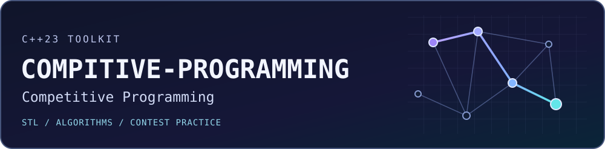

# COMPITIVE-PROGRAMMING




[](https://github.com/JESAN-HR/COMPITIVE-PROGRAMMING/actions/workflows/ci.yml)

A C++23 Competitive Programming toolkit. Learn the standard library with runnable lessons, trace the invariants behind core algorithms, and reuse tested headers in your own contest practice.

## Contents

[Features](#features) · [Quick start](#quick-start) · [Example](#example) · [STL lessons](#stl-lessons) · [Algorithm index](#algorithm-index) · [Practice](#practice) · [Repository layout](#repository-layout) · [Testing](#testing) · [Documentation](#documentation) · [Contributing](#contributing) · [Provenance](#provenance)

## Features

- **Learn by running.** The STL lessons pair deterministic output with container costs and common mistakes.
- **Reuse by including a header.** The `cp` library uses standard C++ and has no build-time library dependencies.
- **Practice by comparing approaches.** The sample problem explains its correctness and ships with input/output fixtures you can use to check your own solution.

## Quick start

Use the following commands on Ubuntu 24.04 with CMake 3.25+ and GCC 14 installed.

```bash
git clone https://github.com/JESAN-HR/COMPITIVE-PROGRAMMING.git
cd COMPITIVE-PROGRAMMING
cmake -S . -B build -DCMAKE_CXX_COMPILER=g++-14 -DCMAKE_BUILD_TYPE=Release
cmake --build build --parallel
ctest --test-dir build --output-on-failure --no-tests=error
./build/algorithms_demo
```

The build guide includes Windows commands and troubleshooting. [Build guide](docs/getting-started.md)

## Example

Find the block of tied scores in a sorted sequence. The lower and upper boundaries are zero-based, with an exclusive upper bound.

```cpp
#include <cp/algorithms/binary_search.hpp>

#include <array>
#include <iostream>
#include <span>

int main() {
    const std::array scores{2, 4, 4, 9};
    const auto first = cp::lower_bound_index(std::span{scores}, 4);
    const auto past = cp::upper_bound_index(std::span{scores}, 4);
    std::cout << first << ' ' << past << '\n'; // 1 3
}
```

The [algorithm demo](src/examples/algorithms.cpp) shows each core implementation. To build your own program, add `include/` to the compiler’s header search path, or link your CMake target to `cp::cp`.

## STL lessons

| Lesson | Contest application |
| --- | --- |
| [Sequences and text](src/stl/sequences.cpp) | Store changing input, track fixed counts, and slice text with `string_view` |
| [Associative containers](src/stl/associative.cpp) | Count frequencies, track seen values, and look up ordered boundaries |
| [Container adapters](src/stl/adapters.cpp) | Maintain a frontier, undo stack, or priority queue |
| [Algorithms and utilities](src/stl/algorithms.cpp) | Sort records, find duplicate ranges, and unpack tuples |
| [Ranges and views](src/stl/ranges.cpp) | Filter and transform lazily, then group results into batches |

The [STL guide](docs/stl-guide/README.md) gives expected output, runtime costs, and pitfalls for each lesson.

## Algorithm index

| Topic | Implementations | Guide |
| --- | --- | --- |
| Search and sort | [Binary search and boundaries](include/cp/algorithms/binary_search.hpp), [stable merge sort](include/cp/algorithms/merge_sort.hpp) | [Algorithms](docs/algorithms/README.md) |
| Range queries and primes | [Prefix sums](include/cp/algorithms/prefix_sums.hpp), [Sieve of Eratosthenes](include/cp/algorithms/sieve.hpp) | [Algorithms](docs/algorithms/README.md) |
| Graphs | [BFS and DFS](include/cp/algorithms/graph_traversal.hpp), [Dijkstra](include/cp/algorithms/dijkstra.hpp) | [Algorithms](docs/algorithms/README.md) |
| Data structures | [Disjoint Set Union](include/cp/data_structures/disjoint_set_union.hpp), [Fenwick Tree](include/cp/data_structures/fenwick_tree.hpp) | [Data structures](docs/data-structures/README.md) |
| Contest utilities | [Fast I/O starter](templates/contest.cpp), [modular arithmetic](include/cp/utils/modular.hpp) | [Templates](templates/README.md) |

The guides cover preconditions, complexity, edge cases, and worked examples.

## Practice

Solve **CP-001 · Checkpoint Scores** to practice turning one-based inclusive queries into half-open ranges. The [problem index](problems/README.md) links the original exercise, reference solution, explanation, and CTest fixtures.

## Repository layout

| Path | Contents |
| --- | --- |
| [`include/cp/`](include/cp/) | Header-only algorithms, data structures, and utilities |
| [`src/stl/`](src/stl/) and [`src/examples/`](src/examples/) | Standard-library lessons and reusable-header demonstrations |
| [`templates/`](templates/) and [`problems/`](problems/) | Contest starter and practice solutions |
| [`tests/`](tests/) | Deterministic tests and input/output fixtures |
| [`docs/`](docs/) | Build, reference, and learning guides |
| [`.github/workflows/`](.github/workflows/) | Linux GCC and Windows MSVC CI configuration |

## Testing

After building, run `ctest --test-dir build -C Release --output-on-failure --no-tests=error`. Use the directory you configured. Tests exercise empty and singleton inputs, duplicate boundaries, sorted input, invalid indices, disconnected graphs, and arithmetic limits. CTest also runs the examples and checks exact output for the template and problem fixtures.

## Documentation

- [Build guide](docs/getting-started.md) for Linux and Windows commands.
- [C++23 features](docs/cpp23-features.md) for language mode and feature detection.
- [Learning guide](docs/learning-guide.md) for an order of study and exercises to try yourself.
- [Roadmap](docs/roadmap.md) for proposed development milestones.

## Contributing

Bring a focused change with a runnable example, a clear input contract, and tests for its edge cases. See the [contribution guide](CONTRIBUTING.md) for review and attribution expectations.

## Provenance

The root [`STL.cpp`](STL.cpp) predates the toolkit and was retained as historical reference. It came from another programmer, and its source, author credit, and redistribution terms are unresolved. CMake excludes it. The toolkit examples and modules were developed independently of that file with AI assistance and are intended for study and review. A repository-wide license is pending a rights review.
